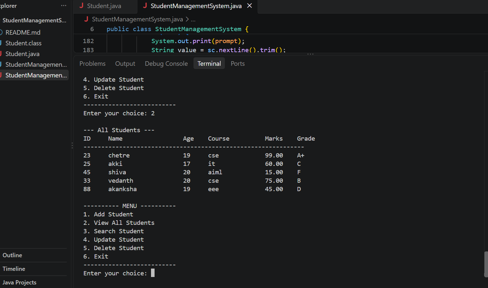

# Student Management System (Java)

A console-based Java application for managing student records. The project demonstrates core Java and Object-Oriented Programming (OOP) concepts through a simple menu-driven interface.

## Features

Add a student record
View all student records
Search for a student by ID
Update student details
Delete a student record
Calculate a grade from student marks
Validate user input
Store records in a `LinkedHashMap` while preserving insertion order

## Technologies

Java
Object-Oriented Programming (classes, objects, encapsulation, constructors, and methods)
Java Collections Framework (`LinkedHashMap`)
VS Code / terminal

## Project files

Text:
student-management-system/
Student.java
StudentManagementSystem.java
README.md
.gitignore

## Requirements

Java Development Kit (JDK) installed
A terminal or Java-compatible IDE, such as VS Code

Check that Java is installed:

bash:
java -version
javac -version

## How to run

Open a terminal in the project folder and compile both Java files:

bash:
javac Student.java StudentManagementSystem.java

Run the application:

bash:
java StudentManagementSystem

Follow the menu displayed in the terminal to add, view, search, update, or delete student records.

## What I learned

Designing Java classes and objects
Encapsulation using private fields and getters/setters
Using constructors and methods
Managing records with a collection
Building menu-driven console applications
Validating user input

## Future improvements

Save records permanently in a file or database
Add a graphical user interface
Add sorting and filtering
Add unit tests
Connect the application to a database such as MySQL

## Screenshots

Add a screenshot of the running application here after uploading it to this repository. For example, create a `screenshots` folder and upload an image named `main-menu.png`, then uncomment the lines below:

<!--

-->

## Author

GitHub: [@chetreashu307-collab](https://github.com/chetreashu307-collab)

If you find this project useful, feel free to star the repository.
